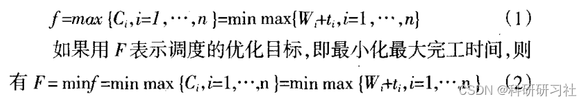
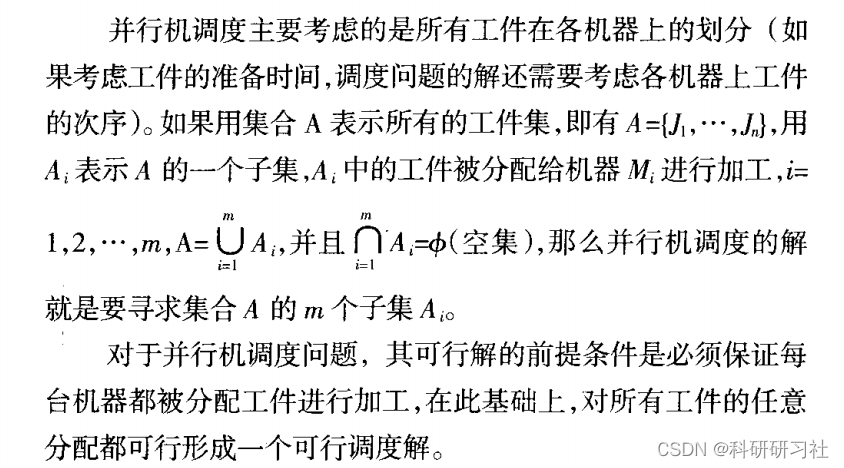
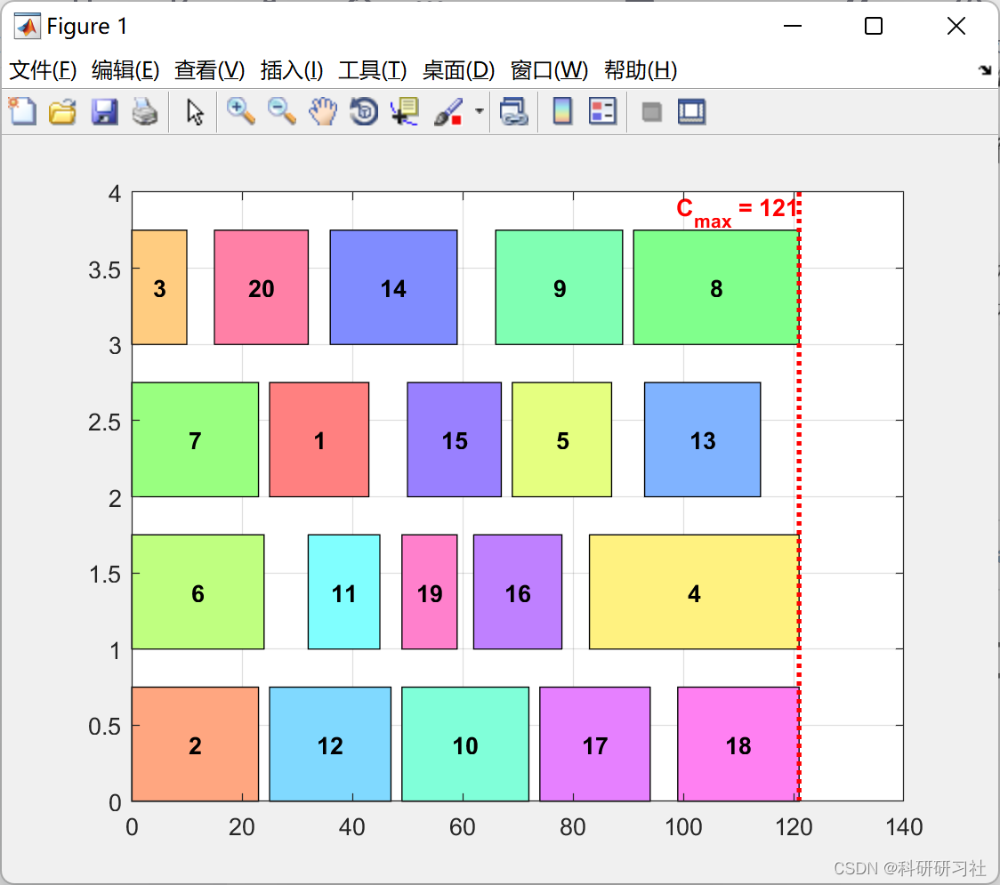
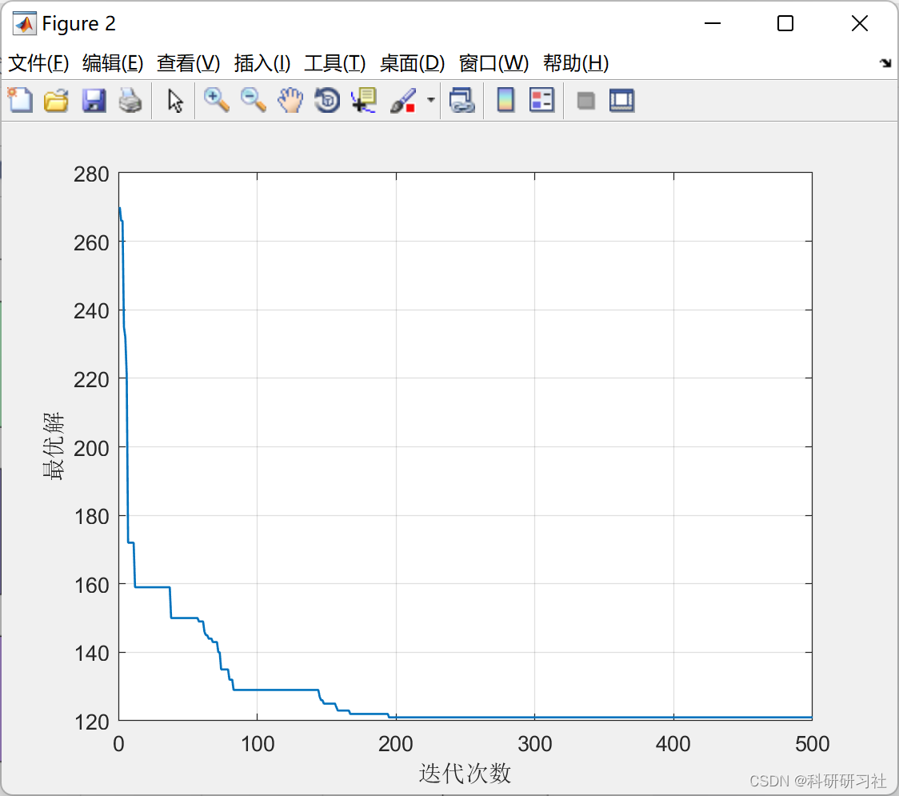

# [Shop Scheduling] Parallel Shop Machine Optimized Scheduling Based on Simulated Annealing Algorithm (Matlab Code Implementation)

1. Overview of Parallel Machine Scheduling (also known as the Parallel Multi-Machine Scheduling Problem, PMSP) is a typical scheduling problem in actual production processes. It involves the processing of n jobs on m machines, where each job has only one operation. In parallel machine scheduling problems, when each machine can accommodate the processing of all jobs, the scheduling solution mainly considers how to divide the m machines among the n jobs. This means, how to assign m machines to n jobs. The optimization objective for the parallel machine scheduling problem, which aims to minimize the maximum completion time, has been proven to be an NP-complete problem.
2. Description of Parallel Machine Scheduling Problem
For the parallel machine scheduling problem with n jobs and m machines, if we do not consider the preparation time between the processing of different jobs on the same machine, denoted as t_i, i being the job index, W as the waiting time during processing, C as the completion time of the job, and f as the maximum completion time of all jobs, then the problem can be described as follows:
3. Simulated Annealing Method - Intelligent Optimization Algorithm - Simulated Annealing (Python & Matlab implementation)
4. Parallel Shop Machine Optimized Scheduling Based on Simulated Annealing Optimization Algorithm (Matlab Code Implementation)
4.1 Run Results
​
4.2 Matlab Code
This article only showcases part of the code, click the following link for the full code:
[Shop Scheduling]Parallel Shop Machine Optimized Scheduling Based on Simulated Annealing Optimization Algorithm (Matlab Code Implementation)
\n\nfunction sol=ParseSolution(q,model)\n\n    I=model.I;\n    J=model.J;\n    p=model.p;\n    s=model.s;\n    \n    % Delimiters Position\n    DelPos=find(q>I);\n    \n    % Determine Start and End of Machines Job Sequence\n    From=[0 DelPos]+1;\n    To=[DelPos I+J]-1;\n    \n    % Create Jobs List\n    L=cell(J,1);\n    for j=1:J\n        L{j}=q(From(j):To(j));\n    end\n    \n    % Time-based Simulation\n    ST=zeros(I,1);\n    PT=zeros(I,1);\n    FT=zeros(I,1);\n    MCT=zeros(J,1);\n    for j=1:J\n        for i=L{j}\n            k=find(L{j}==i);\n            if k==1\n                ST(i)=0;\n            else\n                PreviousJob=L{j}(k-1);\n                ST(i)=FT(PreviousJob)+s(PreviousJob,i,j);\n            end\n            \n            PT(i)=p(i,j);\n            \n            FT(i)=ST(i)+PT(i);\n        end\n        \n        if ~isempty(L{j})\n            MCT(j)=FT(L{j}(end));\n        end\n        \n    end\n    \n    Cmax=max(MCT);\n    \n    sol.L=L;\n    sol.ST=ST;\n    sol.PT=PT;\n    sol.FT=FT;\n    sol.MCT=MCT;\n    sol.Cmax=Cmax;\n\nend\n  
Designed for parallel machine scheduling problems, the particle swarm optimization algorithm is proposed. It first introduces particle coding methods based on machines and PPR, as well as on jobs and PPS. To address the issue of generating unfeasible scheduling solutions in the particle coding method based on machines and PPR, an improved particle swarm algorithm is developed, which significantly improves the optimization results. On this basis, this paper presents the steps for the particle swarm algorithm using two different particle coding methods.
Secondly, the particle swarm algorithm, based on the aforementioned two different particle representation methods, is tested on two different scale examples: the 7-job 3-machine parallel machine scheduling problem and the 30-job 10-machine parallel machine scheduling problem. The experimental results show that both particle swarm algorithms using different particle coding methods can achieve good optimization results. Among them, the particle swarm algorithm based on the job and PPS particle coding method performs better in optimization performance. For the 30-job 10-machine parallel machine scheduling problem, its computational results are superior to those of genetic algorithms.
References:
[1] Liu Min, Wu Cheng. Application of Evolutionary Programming Methods in Minimizing Delayed Task Number Parallel Machine Scheduling Problem [J]. Journal of Electronics, 1999, 27(7):132-134
[2] Liu Min, Wu Cheng, Yang Yingjie. A Genetic Algorithm Based on Combinatorial Rules for Parallel Multi-Machine Scheduling Problem [J]. Journal of Electronics, 2000, 28(5):52-54
[3] Liu Zhixiong. Research on Particle Swarm Optimization for Parallel Machine Scheduling Problems [J]. Mechanical Design and Manufacturing, 2010(10):68-70

## Images

<!-- PAYMENT_BLOCK -->

## Get this dataset

- Payment link (Stripe): [Buy now](https://buy.stripe.com/3cs8yP7sY87d0vu9AB)
- Payment QR code: 

<!-- /PAYMENT_BLOCK -->
